# 🗺️ MAPA DEL PROYECTO — ARK CASH REGISTER (v2.1)

**Producto:** Ark-cajaregistradora (`pey-worker`)  
**Ecosistema:** ARK Systems (Substrate Holdings LLC)  
**Integración Bancaria & Rieles:**
- 🇲🇽 **CoDi® Banxico** (OpenAPI v2026-10-20 / Pey API — 0% comisión hasta $8,000 MXN)
- ⚡ **SPEI Directo** (Montos > $8,000 MXN sin límite de mayoreo)
- 💳 **Tarjetas & Meses Sin Intereses** (PayPal REST v2 — 3, 6, 9 y 12 MSI)
- 💵 **Dólares Digitales** (Solana Pay USDC/USDT SPL no-custodial)
- 🚚 **Logística Multicarrier Nacional** (Envia.com — FedEx, Estafeta, Redpack)
- ✨ **Estudio Fotográfico IA** (Cloudflare Workers AI — `@cf/black-forest-labs/flux-1-schnell` + R2 WebP)
- 🧾 **Facturación Electrónica** (SAT CFDI 4.0 vía Facturapi)
- ⚖️ **Compliance Normativo** (Ley Antilavado LFPIORPI Art. 17 Fracc. XVI con sellado SHA-256)

**Infraestructura:** Cloudflare Workers (TypeScript / Hono v4) + D1 SQLite (`ark_caja_db`) + KV Cache (`ark-caja-kv-cache`) + R2 (`ark-cash-invoices`) + Workers AI + PWA  
**Última actualización:** Noviembre 2026  
**Estado:**
- Typecheck `tsc --noEmit`: **0 errores**
- Tests Vitest: **118/118 pasando (11 archivos de prueba)**
- Despliegue en producción: **Activo en `https://caja.arksystems.site`**

---

## 1. Esquema de Directorios y Archivos

```
ark-cash-register/
├── docs/
│   ├── ark-cash-register.md       # Documento maestro de diseño y especificaciones (22 secciones)
│   ├── map.md                     # Este documento: mapa integral, arquitectura y checklist de pendientes
│   ├── auth-plan.md               # Plan de auth soberano y tokens
│   ├── compliance-plan.md         # Plan de compliance / ARCO / LFPIORPI
│   ├── dr-plan.md                 # Plan de recuperación ante desastres
│   ├── dpo.md                     # Delegado de Protección de Datos
│   ├── dpa-pey.md                 # Acuerdos de procesamiento de datos con Pey
│   └── dpa-facturapi.md           # Acuerdos de procesamiento de datos con Facturapi
├── migrations/                    # Migraciones D1 SQLite (13 aplicadas en orden)
│   ├── 0001_initial_schema.sql             # merchants, payments, ledger_entries, webhook_events
│   ├── 0002_operator_audit_and_closes.sql   # operator_audit_log, daily_closes
│   ├── 0003_auth.sql                       # users, auth_sessions, email_verification_tokens, ...
│   ├── 0004_compliance.sql                 # consent_records, arco_requests, versions, purge_log
│   ├── 0005_mfa.sql                        # user_mfa (TOTP RFC 6238)
│   ├── 0006_invoices.sql                   # fiscal_profiles, invoices (CFDI 4.0)
│   ├── 0007_webhook_idempotency.sql        # idempotency_key, índice único en webhook_events
│   ├── 0008_spei_fallback.sql              # amount_mxn_equiv, payment_rail, currency, solana_*
│   ├── 0009_digital_dollars_lfpiorpi.sql   # lfpiorpi_evaluaciones (Art. 17 Fracc. XVI)
│   ├── 0010_paypal_rail.sql                # paypal_client_id, paypal_orders, payment_rail 'paypal'
│   ├── 0011_fix_foreign_keys.sql           # corrección de integridad referencial D1
│   ├── 0012_merchant_tier_and_ai_photos.sql# subscription_tier (free/pro), ai_photos, catalog_images
│   └── 0013_merchant_shipping.sql          # merchant_shipping_config, shipping_labels, quotes
├── public/                        # Assets estáticos servidos desde el Edge (PWA Frontend)
│   ├── index.html                 # Landing pública (Multi-Riel, Freemium Free vs Pro, Envíos, Fotos IA, FAQ)
│   ├── caja.html                  # Mostrador TPV (Teclado táctil, QR CoDi, Envíos & Guías, Arqueo, Upgrade)
│   ├── tienda.html                # Tienda online (/tienda?m=...): catálogo, variantes, cotizador Envia.com, CoDi/PayPal MSI/WhatsApp
│   ├── instructivo.html           # Guía operativa de mostrador
│   ├── landing.html               # Alias institucional
│   ├── verify-email.html          # Verificación de cuenta (Auth)
│   ├── reset-password.html        # Restablecimiento seguro de contraseña
│   ├── privacy.html               # Aviso de privacidad legal
│   ├── terms.html                 # Términos y condiciones
│   ├── sw.js                      # Service Worker (caché offline y estrategia Network-First con fallback)
│   ├── manifest.json              # Manifiesto PWA instalable
│   ├── favicon.svg | logo.svg | badge-pey.svg | *.svg | *.png
│   └── (pattern.svg, pey-codi-logo.png, phone-frame.png, og-image.svg)
├── src/                           # Backend Cloudflare Worker (TypeScript / Hono v4)
│   ├── index.ts                   # Router Hono principal, CORS, logger, healthcheck, redirects, scheduled
│   ├── types.ts                   # Tipos: Env, CODI_MAX_MXN=8000, Solana mints, LFPIORPI, tiers, shipping
│   ├── data/
│   │   └── catalogs.ts            # Catálogos demo iniciales aislados por tenant (Taquería, SkinLab)
│   ├── middleware/
│   │   ├── auth.ts                # requireAuth, requireRole, optionalAuth, requireMerchantAuth (JWT HS256)
│   │   └── staypuftAuth.ts        # Fail-closed con X-StayPuft-Key para conector administrativo
│   ├── routes/
│   │   ├── ai.ts                  # /api/ai/close-summary, /api/ai/suggest-sat-key (Workers AI Llama 3.1)
│   │   ├── auth.ts                # /api/auth/* (register, login, refresh, logout, MFA, reset, sessions)
│   │   ├── catalog.ts             # /api/merchant/:id/catalog/*, generate-images (Flux.1), tier, upgrade
│   │   ├── codi.ts                # /api/codi/qr, /api/payment/codi/* (qr, simulate-payment, pn)
│   │   ├── compliance.ts          # /api/legal/versions, /api/privacy/* (ARCO), backup manual
│   │   ├── internal.ts            # /api/internal/* (StayPuft admin: status, metrics, ledger, lfpiorpi)
│   │   ├── invoices.ts            # /api/fiscal/profile, /api/invoice/* (issue CFDI 4.0, cancel, pdf, xml)
│   │   ├── merchant.ts            # /api/merchant/* (register, catalog CRUD, payments, close-day, spei)
│   │   ├── paymentLink.ts         # /api/payment-link, /api/payment/link/*
│   │   ├── paypal.ts              # /api/merchant/:id/paypal/* (create-order, capture-order, order-status)
│   │   ├── shipping.ts            # /api/merchant/:id/shipping/* (quote, label, track, config, labels)
│   │   ├── solana.ts              # /api/solana/* (order, status, confirm-payment, offramp-info)
│   │   └── webhooks.ts            # /webhooks/pey, /api/webhooks/pey (HMAC-SHA256, anti-replay, idempotencia)
│   ├── services/
│   │   ├── aiClient.ts            # Chat Llama 3.1 8B Instruct vía Cloudflare Workers AI
│   │   ├── backup.ts              # Snapshot semanal D1 → R2 en formato JSON por tabla
│   │   ├── catalogImageGenerator.ts# Generación comercial Flux-1-schnell en Workers AI + R2 WebP
│   │   ├── enviaService.ts        # Integración multicarrier Envia.com (cotización, guías PDF, tracking)
│   │   ├── facturapiClient.ts     # Timbrado PAC CFDI 4.0 SAT con Facturapi
│   │   ├── lfpiorpi.ts            # Evaluador Art. 17 Fracc. XVI LFPIORPI con dictamen criptográfico SHA-256
│   │   ├── paypalClient.ts        # Cliente PayPal REST v2 (OAuth2 bearer, órdenes, capturas, MSI)
│   │   ├── peyClient.ts           # Cliente HTTP Pey CoDi API (OpenAPI v2026-10-20)
│   │   └── resendClient.ts        # Envío de correos transaccionales (verificación, recuperación)
│   └── utils/
│       ├── clabe.ts               # Validación matemática de CLABE 18 dígitos (checksum Banxico)
│       ├── crypto.ts              # PBKDF2 (100k iter), JWT HS256, tokens opacos, sha256
│       ├── rateLimit.ts           # Sliding window en KV (IP/email)
│       ├── solana.ts              # Validación Base58 wallet Solana, referencia única 32b, URL Solana Pay
│       ├── totp.ts                # TOTP RFC 6238 nativo sin librerías externas
│       └── ulid.ts                # Generador ULID Crockford Base32
├── tests/                         # Suite Vitest (11 archivos, 118 pruebas unitarias y de integración)
│   ├── ai.test.ts                         # 3 pruebas (Workers AI corte y claves SAT)
│   ├── auth.test.ts                       # 15 pruebas (registro, login, cookies, rotación, MFA)
│   ├── freemium_ai_catalog.test.ts        # 9 pruebas (paywall free vs pro, generación fotos Flux.1)
│   ├── internal.test.ts                   # 14 pruebas (StayPuft conector administrativo)
│   ├── invoices.test.ts                   # 4 pruebas (CFDI 4.0 Facturapi + R2)
│   ├── p0_auth_pagination_idempotency.test.ts # 18 pruebas (seguridad base P0)
│   ├── paypal.test.ts                     # 9 pruebas (PayPal REST v2 órdenes, capturas, MSI)
│   ├── shipping_envia.test.ts             # 7 pruebas (cotizaciones, emisión guías PDF, tracking)
│   ├── solana_lfpiorpi.test.ts            # 16 pruebas (Solana Pay + compliance LFPIORPI)
│   ├── spei_fallback.test.ts              # 13 pruebas (umbral CoDi $8,000 MXN vs SPEI directo)
│   └── storefront.test.ts                 # 14 pruebas (catálogo aislado, carrito, checkout)
├── wrangler.toml                  # Configuración Cloudflare Workers: D1, KV, R2, AI, vars y bindings
└── package.json                   # Dependencias: Hono ^4.13.17 | Dev: @cloudflare/workers-types, vitest, typescript
```

---

## 2. Arquitectura de Flujo Multi-Riel y Servicios

```mermaid
flowchart TD
    subgraph FRONTEND["Frontend PWA (Edge Assets / Cloudflare Pages)"]
        UI_CAJA["/caja: Mostrador TPV\n- Teclado táctil de cobro rápido\n- QR CoDi Banxico en vivo\n- Botón Envíos & Guías Oficiales\n- Arqueo & Corte diario con IA\n- Modal Upgrade a Ark Pro"]
        UI_TIENDA["/tienda: Tienda Online del Negocio\n- Catálogo dinámico con variantes (S/M/L)\n- Fotos generadas por IA (Flux.1)\n- Selector entrega: Mostrador o Envío\n- Cotizador en vivo FedEx / Estafeta (C.P.)\n- Checkout Multi-Riel"]
        UI_LANDING["/index: Landing Page Institucional\n- Tabla comparativa Free vs Ark Pro ($299)\n- Rieles de pago y demos interactivas\n- Calculadora de beneficios y FAQ"]
    end

    subgraph WORKER["Cloudflare Worker (pey-worker / Hono Router)"]
        ROUTER["Router Hono + CORS + Headers de Seguridad"]
        
        %% Rieles
        R_CODI["Riel CoDi® Banxico\n(POST /api/codi/qr - máx $8,000 MXN)"]
        R_SPEI["Riel Fallback SPEI\n(POST /api/merchant/:id/spei-order - montos altos)"]
        R_PAYPAL["Riel PayPal REST v2\n(POST /api/merchant/:id/paypal/* - Tarjetas & MSI)"]
        R_SOLANA["Riel Solana Pay\n(POST /api/solana/order - USDC/USDT no-custodial)"]
        
        %% Servicios
        S_SHIP["Logística Envia.com\n(/api/merchant/:id/shipping/*)"]
        S_AI_CAT["Estudio Fotos IA\n(/api/merchant/:id/catalog/generate-images)"]
        S_INV["Facturación SAT CFDI 4.0\n(/api/invoice/*)"]
        S_TIER["Paywall & Tiers\n(Free vs Pro Gatekeeper)"]
        S_AUTH["Auth Soberano & Sesiones\n(/api/auth/*)"]
    end

    subgraph STORAGE["Almacenamiento Cloudflare"]
        D1[("D1 SQLite: ark_caja_db\n- 21 tablas transaccionales\n- merchants, payments, orders\n- catalog_images, shipping_labels\n- paypal_orders, lfpiorpi_eval")]
        KV[("KV Namespace\n- Sesiones, rate limiting\n- Caché cotizaciones de envío\n- Catálogos temporales")]
        R2[("R2 Object Storage\n- XML CFDI timbrados\n- Fotos WebP de catálogo\n- Backups semanales D1")]
    end

    subgraph PARTNERS["Integraciones & Rieles Externos"]
        PEY["Pey API / Banxico\n(CoDi QR oficial & Push)"]
        PAYPAL_API["PayPal API REST v2\n(Credit Card & MSI Processing)"]
        ENVIA_API["Envia.com API\n(FedEx, Estafeta, Redpack)"]
        WORKERS_AI["Cloudflare Workers AI\n(Flux.1 Schnell & Llama 3.1)"]
        FACTURAPI["Facturapi (PAC SAT)"]
        SOL_CHAIN["Blockchain Solana"]
    end

    %% Conexiones Frontend -> Worker
    UI_CAJA -->|Cobro CoDi Mostrador| R_CODI
    UI_CAJA -->|Gestión de Guías y Envíos| S_SHIP
    UI_CAJA -->|Generar Fotos con IA| S_AI_CAT

    UI_TIENDA -->|Cotizar envío por C.P.| S_SHIP
    UI_TIENDA -->|Pago con CoDi| R_CODI
    UI_TIENDA -->|Pago Tarjeta / MSI| R_PAYPAL
    UI_TIENDA -->|Pago Cripto USDC| R_SOLANA
    UI_TIENDA -->|Transferencia SPEI| R_SPEI

    %% Conexiones Worker -> Gate & Storage
    S_AI_CAT --> S_TIER
    S_SHIP --> S_TIER
    R_PAYPAL --> S_TIER
    S_TIER --> D1

    %% Conexiones Worker -> Partners
    R_CODI --> PEY
    R_PAYPAL --> PAYPAL_API
    S_SHIP --> ENVIA_API
    S_AI_CAT --> WORKERS_AI
    WORKERS_AI -->|Guarda WebP| R2
    S_INV --> FACTURAPI
    FACTURAPI -->|Guarda XML| R2
    R_SOLANA --> SOL_CHAIN
```



---

## 3. Matriz de Endpoints por Módulo

### 3.1 Rieles de Cobro & Pagos

| Endpoint | Método | Acceso | Propósito | Estado |
|---|---|---|---|---|
| `POST /api/codi/qr` | POST | Público / Caja | Genera QR CoDi Banxico oficial (tope $8,000 MXN) | ✅ Listo |
| `POST /api/codi/pn` | POST | Público / Caja | Notificación push CoDi a celular (10 dígitos) | ✅ Listo |
| `POST /api/codi/simulate-payment` | POST | Demo | Simulación instantánea de pago para hackathon | ✅ Listo |
| `GET /api/payment/codi/qr/:id` | GET | Público | Polling de estado de cobro CoDi | ✅ Listo |
| `POST /api/merchant/:id/spei-order` | POST | Tienda / Caja | Orden SPEI para ventas mayoreo (> $8,000 MXN) | ✅ Listo |
| `POST /api/merchant/:id/payments/:paymentId/confirm-spei` | POST | Cajero | Confirmación manual de pago SPEI en mostrador | ✅ Listo |
| `POST /api/merchant/:id/paypal/create-order` | POST | Tienda Ark Pro | Crea orden de pago con tarjeta / MSI vía PayPal REST v2 | ✅ Listo |
| `POST /api/merchant/:id/paypal/capture-order` | POST | Tienda Ark Pro | Captura fondos de PayPal y acredita el pago en D1 | ✅ Listo |
| `GET /api/merchant/:id/paypal/order/:orderId` | GET | Tienda / Caja | Consulta estado de transacción PayPal | ✅ Listo |
| `POST /api/solana/order` | POST | Tienda / Caja | Crea orden de pago en Dólares Digitales (USDC/USDT) | ✅ Listo |
| `POST /api/solana/confirm-payment` | POST | Público | Verificación on-chain de transacción Solana Pay | ✅ Listo |
| `POST /webhooks/pey` | POST | Pey Webhook | Ingesta transacciones con HMAC-SHA256 e idempotencia | ✅ Listo |

### 3.2 Logística y Envíos (Envia.com) — Exclusivo Ark Pro

| Endpoint | Método | Acceso | Propósito | Estado |
|---|---|---|---|---|
| `POST /api/merchant/:id/shipping/quote` | POST | Tienda / Carrito | Cotiza paqueterías (FedEx, Estafeta, Redpack) con C.P. | ✅ Listo |
| `POST /api/merchant/:id/shipping/label` | POST | Caja / TPV | Emite guía oficial en PDF y número de rastreo | ✅ Listo |
| `GET /api/merchant/:id/shipping/track/:carrier/:trackingNumber` | GET | Tienda / Caja | Rastreo de checkpoints del paquete en camino | ✅ Listo |
| `GET /api/merchant/:id/shipping/labels` | GET | Caja TPV | Historial de guías generadas por el comercio | ✅ Listo |
| `GET /api/merchant/:id/shipping/config` | GET | Merchant Admin | Configuración de dirección de origen del comercio | ✅ Listo |
| `PUT /api/merchant/:id/shipping/config` | PUT | Merchant Admin | Actualiza origen y credenciales de paquetería | ✅ Listo |

### 3.3 Catálogo, Paywall Freemium & Fotos IA

| Endpoint | Método | Acceso | Propósito | Estado |
|---|---|---|---|---|
| `GET /api/merchant/:id/tier` | GET | Público / Caja | Consulta tier del comercio (`free` o `pro`) y cuotas | ✅ Listo |
| `POST /api/merchant/:id/upgrade` | POST | Merchant Admin | Ascenso de comercio a plan `pro` (Ark Pro) | ✅ Listo |
| `POST /api/merchant/:id/catalog/generate-images` | POST | Ark Pro (2 en Free) | Genera fotos de producto con Workers AI (Flux.1 Schnell) | ✅ Listo |
| `GET /api/merchant/:id/catalog/images` | GET | Público / Tienda | Lista fotos generadas con metadata y URLs en R2 | ✅ Listo |
| `GET /api/merchant/:id/catalog` | GET | Público / Tienda | Catálogo dinámico con variantes y fotos | ✅ Listo |
| `PUT /api/merchant/:id/catalog` | PUT | Merchant Admin | Actualiza productos y existencias | ✅ Listo |

### 3.4 Facturación Fiscal & Compliance

| Endpoint | Método | Acceso | Propósito | Estado |
|---|---|---|---|---|
| `POST /api/invoice/issue` | POST | Caja / Público | Timbrado oficial CFDI 4.0 SAT (Facturapi + R2) | ✅ Listo |
| `GET /api/invoice/:id/pdf` | GET | Público | Descarga/visualización de representación impresa PDF | ✅ Listo |
| `GET /api/invoice/:id/xml` | GET | Público | Descarga de comprobante fiscal XML timbrado | ✅ Listo |
| `POST /api/merchant/:id/close-day` | POST | Cajero | Corte de caja con arqueo fiscal por riel e IVA/IEPS | ✅ Listo |
| `POST /api/ai/close-summary` | POST | Cajero | Resumen ejecutivo inteligente del corte con Workers AI | ✅ Listo |
| `POST /api/ai/suggest-sat-key` | POST | Merchant | Sugerencia automática de claves de producto SAT | ✅ Listo |
| `POST /api/internal/lfpiorpi/evaluar` | POST | StayPuft Admin | Evaluación preventiva antilavado y dictamen SHA-256 | ✅ Listo |

---

## 4. Estado de Features Implementadas (Completadas ✅)

- [x] **Riel CoDi® Banxico Soberano (0% Comisión):**
  - Integración nativa con OpenAPI v2026-10-20 de Pey.
  - Generación de QR dinámico con monto bloqueado hasta $8,000 MXN en < 200 ms.
  - Polling dual resiliente y receptor de webhooks con firma HMAC-SHA256, anti-replay e idempotencia estricta.
- [x] **Riel Fallback SPEI para Mayoreo:**
  - Desvío automático sin fricción para montos mayores a $8,000 MXN.
  - Despliegue de CLABE interbancaria de 18 dígitos validada por checksum Banxico.
  - Confirmación manual en mostrador con auditoría y asiento contable inmediato.
- [x] **Riel PayPal REST v2 (Tarjetas & Meses Sin Intereses):**
  - Creación y captura de órdenes vía PayPal Checkout en servidor.
  - Soporte de **3, 6, 9 y 12 Meses Sin Intereses (MSI)** para tarjetas mexicanas.
  - Cero necesidad de renta de terminal física POS.
- [x] **Riel Dólares Digitales (Solana Pay USDC/USDT):**
  - Cobro peer-to-peer en 1 segundo con liquidación final en la wallet de autocustodia del negocio.
  - Evaluación previa bajo la Ley Antilavado LFPIORPI con dictamen criptográfico SHA-256.
- [x] **Estudio Fotográfico de Catálogo con IA:**
  - Modelo `@cf/black-forest-labs/flux-1-schnell` ejecutado en Cloudflare Workers AI.
  - Conversión y almacenamiento de imágenes en formato WebP en Cloudflare R2 con hashes de contenido para deduplicación.
  - Cuotas gestionadas por tier (2 fotos gratis en Free, 50 fotos/mes en Ark Pro).
- [x] **Logística Multicarrier Nacional (Envia.com):**
  - Cotización en tiempo real en `/tienda` al ingresar Código Postal (FedEx, Estafeta, Redpack).
  - Emisión de guías oficiales en PDF en 1 solo clic desde el Mostrador TPV `/caja`.
  - Historial de envíos y consulta de checkpoints de tracking en vivo.
- [x] **Arquitectura Freemium & Paywalling por Tenant:**
  - Separación clara: **Básico Free** ($0 MXN/mes, CoDi Banxico 0% ilimitado, mostrador físico) vs **Ark Pro** ($299 MXN/mes, e-commerce, envíos, fotos IA, tarjetas MSI).
  - Middleware de control de acceso por suscripción en backend.
- [x] **Facturación SAT CFDI 4.0:**
  - Timbrado ante el SAT vía Facturapi (Público en General e individual por RFC).
  - Almacenamiento seguro del XML timbrado en Cloudflare R2.
- [x] **Frontend PWA & Tienda Online Aislada:**
  - Mostrador `/caja` optimizado para pantallas táctiles y tablets bajo el sol.
  - Tienda en línea `/tienda?m=...` con catálogo, variantes (tallas/sabores) y checkout unificado.
  - Service Worker con soporte offline para cortes de red locales.
- [x] **Landing Page Comercial Actualizada:**
  - Nueva página principal destacando los 4 rieles de pago, la tabla Freemium de precios, el estudio de fotos IA y la logística nacional.

---

## 5. Checklist de Pendientes & Próximos Pasos (Backlog Futuro 📋)

### 5.1 Configuración de Secretos en Producción (Cloudflare Dashboard / CLI)
> **Prioridad:** Alta (requiere tokens provistos por el usuario en Cloudflare)
- [ ] **Registrar credenciales oficiales de PayPal en producción:**
  - `PAYPAL_CLIENT_ID` y `PAYPAL_CLIENT_SECRET` en modo `live` en `caja.arksystems.site`.
- [ ] **Registrar API Key de Envia.com en producción:**
  - `ENVIA_API_KEY` con cuenta de producción y saldo de guías activo.
- [ ] **Registrar credenciales de Pey para CoDi en vivo:**
  - `PEY_API_KEY` y `PEY_WEBHOOK_SECRET` validados con la mesa de control de Pey.
- [ ] **Registrar API Key de Facturapi para timbrado oficial:**
  - `FACTURAPI_API_KEY` con CSD (Certificado de Sello Digital) del emisor cargado en Facturapi.
- [ ] **Registrar API Key de Resend:**
  - `RESEND_API_KEY` con dominio verificado `arksystems.site` para emails transaccionales de verificación de cuenta.

### 5.2 Integraciones Asíncronas y Webhooks de Terceros
> **Prioridad:** Media
- [ ] **Webhook Listener de PayPal REST v2 (`/api/webhooks/paypal`):**
  - Verificación criptográfica del header `PAYPAL-TRANSMISSION-SIG` para capturas asíncronas de órdenes o disputas comerciales.
- [ ] **Webhook Listener de Envia.com (`/api/webhooks/shipping`):**
  - Recepción de eventos de paqueterías (`in_transit`, `out_for_delivery`, `delivered`, `exception`) para actualizar el estado del pedido en D1 sin polling.

### 5.3 Cobro Recurrente y Automatización de Ark Pro
> **Prioridad:** Media
- [ ] **Suscripción mensual recurrente ($299 MXN/mes):**
  - Implementar flujo de cobro recurrente con débito automático a tarjeta mediante PayPal Subscriptions o domiciliación SPEI.
  - Job en Cloudflare Workers Cron (`scheduled`) para renovar cuota mensual de fotos IA (50 créditos) cada 30 días.

### 5.4 Hardware de Mostrador & Punto de Venta Físico
> **Prioridad:** Media / Baja
- [ ] **Impresión Térmica Bluetooth / USB (ESC/POS):**
  - Conexión vía Web Bluetooth API o WebUSB API para imprimir tickets de venta de 58mm/80mm y etiquetas térmicas de paquetería (formato 4x6" para guías de FedEx/Estafeta).
- [ ] **Soporte para Lectores de Código de Barras:**
  - Event listener en `caja.html` para pistolas lectoras HID USB/Bluetooth que agreguen productos al ticket en tiempo real mediante SKU.

### 5.5 Multi-Sucursal y Roles de Cajero (RBAC)
> **Prioridad:** Baja
- [ ] **Gestión de Turnos y Roles de Operador:**
  - Modo cajero con PIN de 4 dígitos para apertura y cierre de turno sin acceso a cambio de CLABE ni métricas financieras globales.
- [ ] **Multi-sucursal por comercio:**
  - Asociación de inventarios y cajas a diferentes códigos postales o sucursales físicas bajo el mismo RFC.

### 5.6 Notificaciones Automatizadas por WhatsApp
> **Prioridad:** Media
- [ ] **WhatsApp Cloud API Transaccional:**
  - Envío automático de confirmación de pago, factura CFDI 4.0 en PDF y liga de rastreo FedEx/Estafeta directamente al número de WhatsApp del cliente (actualmente se genera enlace pre-llenado de `wa.me`).

---

## 6. Métricas de Calidad y Suite de Pruebas

| Archivo de Prueba | Casos | Cobertura Funcional |
|---|:---:|---|
| `tests/auth.test.ts` | 15 | Registro, login, refresh tokens, lockout, MFA TOTP, cookies `__Host-` |
| `tests/p0_auth_pagination_idempotency.test.ts` | 18 | Paginación blindada, deduplicación de webhooks, scoping multi-tenant |
| `tests/spei_fallback.test.ts` | 13 | Límite CoDi $8,000, orden SPEI, confirmación manual, anti-split |
| `tests/paypal.test.ts` | 9 | Creación de órdenes, captura de pagos, Meses Sin Intereses, sandbox/live |
| `tests/shipping_envia.test.ts` | 7 | Cotización multicarrier, generación de guías PDF, checkpoints de rastreo |
| `tests/freemium_ai_catalog.test.ts` | 9 | Paywall Free vs Pro, cuotas de imágenes IA, generación Flux.1 Schnell |
| `tests/solana_lfpiorpi.test.ts` | 16 | Solana Pay no-custodial, ventana móvil 180 días, umbrales UMA, hash SHA-256 |
| `tests/storefront.test.ts` | 14 | Catálogo dinámico, aislamiento entre tiendas, variantes y checkout |
| `tests/internal.test.ts` | 14 | StayPuft conector administrativo, métricas globales, fail-closed 401 |
| `tests/invoices.test.ts` | 4 | Timbrado Facturapi CFDI 4.0, almacenamiento XML en R2 |
| `tests/ai.test.ts` | 3 | Cloudflare Workers AI para cortes de caja y claves fiscales SAT |
| **TOTAL** | **118** | **100% pruebas verdes en Vitest** |
