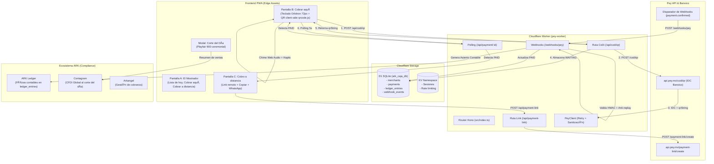

# 🗺️ MAPA DEL PROYECTO — ARK CASH REGISTER (v2.0)

**Producto:** Ark-cajaregistradora (`pey-worker`)  
**Ecosistema:** ARK Systems (Substrate Holdings LLC)  
**Integración Bancaria:** Pey CoDi API (OpenAPI v2026-10-20 / Banxico)  
**Infraestructura:** Cloudflare Workers + D1 Database + KV Cache + PWA  
**Última actualización:** Noviembre 2026  

---

## 1. Esquema de Arquitectura del Proyecto

```
ark-cash-register/
├── docs/
│   ├── ark-cash-register.md     # Documento maestro (22 secciones de diseño y técnica)
│   └── map.md                   # Este documento: mapa integral y checklist de pendientes
├── migrations/
│   ├── 0001_initial_schema.sql  # Esquema D1 SQLite: merchants, payments, ledger_entries, webhook_events
│   └── 0002_operator_audit_and_closes.sql # Auditoría operador (StayPuft) y tabla daily_closes
├── public/                      # Assets servidos desde el Edge (PWA Frontend)
│   ├── index.html               # UI autocontenida: Mostrador (A), QR CoDi (B), Link Remoto (C), Corte de Día
│   ├── sw.js                    # Service Worker para caché offline
│   ├── favicon.svg              # Ícono oficial de la caja registradora
│   └── logo.svg                 # Branding institucional ARK Caja Registradora
├── src/                         # Código fuente del Cloudflare Worker (TypeScript)
│   ├── index.ts                 # Router principal Hono, CORS, logger, healthcheck y dispatch
│   ├── types.ts                 # Tipos TypeScript sincronizados con OpenAPI Pey v2026-10-20
│   ├── middleware/
│   │   └── staypuftAuth.ts      # Auth fail-closed con X-StayPuft-Key y log inmutable en operator_audit_log
│   ├── routes/
│   │   ├── codi.ts              # Endpoints CoDi QR (/api/codi/qr) y Push Notification (/api/codi/pn)
│   │   ├── paymentLink.ts       # Endpoints Cobro Remoto (/api/payment-link)
│   │   ├── merchant.ts          # Registro de CLABE, status Banxico, lista de pagos y corte de caja
│   │   ├── webhooks.ts          # Receptor /webhooks/pey con validación HMAC-SHA256 y anti-replay
│   │   └── internal.ts          # Conector Interno StayPuft (/api/internal/*) solo lectura y diagnóstico
│   ├── services/
│   │   └── peyClient.ts         # Cliente HTTP tipado contra api.pey.mx con retry exponencial y mock local
│   └── utils/
│       └── ulid.ts              # Generador ULID criptográfico Crockford Base32
├── tests/
│   └── internal.test.ts         # Suite de pruebas unitarias Vitest (Auth, Cuotas, Enmascaramiento, HMAC)
├── forge_pey.py                 # Generador Python de assets SVG institucionales
├── package.json                 # Configuración de dependencias (Hono, Wrangler, TypeScript)
├── tsconfig.json                # Configuración de compilación TS para Worker runtime
└── wrangler.toml                # Configuración de Cloudflare Workers, bindings D1, KV y variables
```

---

## 2. Mapa de Integración y Flujo de Datos



---

## 3. Matriz de Endpoints y Mapeo Pey

| Endpoint Worker | Método | Destino Pey | Propósito | Estado |
|---|---|---|---|:---:|
| `/api/health` | `GET` | Local / Worker | Diagnóstico de bindings D1 y KV | ✅ Listo |
| `/api/codi/qr` | `POST` | `/codi/qr` | Genera QR CoDi con `generateImage: false` | ✅ Listo |
| `/api/codi/pn` | `POST` | `/codi/pn` | Envía Push Notification a celular (10 dígitos) | ✅ Listo |
| `/api/payment/codi/:id` | `GET` | `/transaction/codi/qr/:id` | Polling dual de estado de QR | ✅ Listo |
| `/api/payment-link` | `POST` | `/payment-link/create` | Crea enlace para cobro remoto | ✅ Listo |
| `/api/payment/link/:id` | `GET` | `/payment-link/:id` | Polling de estado de enlace remoto | ✅ Listo |
| `/api/merchant/register` | `POST` | `/bank-account` | Onboarding de cuenta CLABE (Banxico) | ✅ Listo |
| `/api/merchant/:id` | `GET` | `/bank-account/:id` | Consulta estado CoDi (`PENDING` / `ACTIVE`) | ✅ Listo |
| `/api/merchant/:id/payments` | `GET` | D1 Local | Historial de pagos para el mostrador | ✅ Listo |
| `/api/merchant/:id/close-day` | `POST` | D1 Local | Corte de caja ceremonial del turno | ✅ Listo |
| `/webhooks/pey` | `POST` | Webhook Receptor | Ingesta de `payment.confirmed` con HMAC | ✅ Listo |

---

## 4. Checklist de lo Construido (Estado Actual)

- [x] **Documento enriquecido oficial:** `docs/ark-cash-register.md` con las 22 secciones.
- [x] **Proyecto Wrangler inicializado:** `wrangler.toml`, `package.json`, `tsconfig.json`.
- [x] **Esquema de base de datos D1:** Migración `0001_initial_schema.sql` ejecutada localmente con tablas `merchants`, `payments`, `ledger_entries` y `webhook_events`.
- [x] **Cliente Pey HTTP tipado:** `PeyClient` con soporte completo OpenAPI v2026-10-20, retry con backoff exponencial, sanitización de metadata y simulador de desarrollo local.
- [x] **Controladores del Worker:**
  - [x] Endpoints CoDi QR con almacenamiento local de IDCs y folios.
  - [x] Endpoints de Payment Links remotos.
  - [x] Receptor de webhooks con verificación de firma HMAC-SHA256 (`crypto.subtle`) y anti-replay.
  - [x] Integración con Ledger contable automático al confirmar pago.
- [x] **Frontend PWA de Mostrador:**
  - [x] Cumplimiento estricto de paleta (`--navy`, `--gold`, `--paid`, `--waiting`, `--expired`).
  - [x] Tipografía `Orbitron 700` para montos, `Inter` para texto, `Playfair Display 900` para corte del día.
  - [x] Teclado numérico táctil de 72px de altura mínima.
  - [x] Renderizado de QR client-side con `qrcode.js` desde `qrString`.
  - [x] Countdown timer de 600 segundos con spinner ámbar.
  - [x] Feedback sonoro (Web Audio API synth) y háptico (`navigator.vibrate`).
  - [x] Botones de "Copiar link" y "Compartir por WhatsApp" en cobro a distancia.
  - [x] Modal de corte del día.
  - [x] Service worker `public/sw.js` para caching estático.
- [x] **Assets visuales:** `public/favicon.svg` y `public/logo.svg` creados con `forge_pey.py`.

---

## 5. Checklist de Faltantes y Siguientes Pasos (Roadmap)

### Fase A — Despliegue y Conexión Cloudflare (Inmediato)
- [ ] **Crear base de datos D1 en Cloudflare Producción:**
  - Comando: `npx wrangler d1 create ark_caja_db`
  - Vincular el `database_id` real generado en `wrangler.toml`.
- [ ] **Crear KV Namespace en Cloudflare Producción:**
  - Comando: `npx wrangler kv namespace create ark-caja-kv-cache`
  - Vincular el `id` en `wrangler.toml`.
- [ ] **Aplicar migraciones D1 en producción:**
  - Comando: `npm run d1:remote`
- [ ] **Configurar Secretos de Producción en Cloudflare:**
  - `npx wrangler secret put PEY_API_KEY` (Key real proporcionada por Pey)
  - `npx wrangler secret put PEY_WEBHOOK_SECRET` (Secreto HMAC configurado en el dashboard de Pey)
- [ ] **Despliegue inicial a Cloudflare:**
  - Comando: `npm run deploy`
  - Configurar dominio personalizado (ej. `caja.arksystems.site` o `caja.arkangel.mx`).

---

### Fase B — Certificación y Pruebas Reales con Pey (24 - 48h)
- [ ] **Configurar URL de Webhook en Dashboard de Pey:**
  - Apuntar a `https://<tu-worker>.workers.dev/webhooks/pey`
  - Seleccionar eventos: `payment.confirmed` y `bank-account.updated`.
- [ ] **Prueba de cobro real de micro-monto en producción ($0.01 o $1.00 MXN):**
  - Abrir la caja desde un teléfono móvil.
  - Generar QR por $1.00 MXN.
  - Escanear con una app bancaria mexicana real (BBVA, Banorte, Santander, Hey Banco, Mercado Pago, etc.) vía sección CoDi.
  - Validar recepción del webhook y disparo inmediato de pantalla "¡Pagado!" + chime sonoro.
- [ ] **Prueba de cobro a distancia por WhatsApp:**
  - Generar link remoto por $1.00 MXN.
  - Pagar mediante tarjeta o CoDi en el checkout oficial de Pey.
  - Validar que el polling detecte la acreditación.

---

### Fase C — Resiliencia Offline Completa (Frontend)
- [ ] **Implementación de IndexedDB en cliente (`public/index.html`):**
  - Crear almacén `offline_sales_queue` en IndexedDB para registrar ventas cuando `navigator.onLine === false`.
  - Mecanismo de sincronización automática en evento `window.addEventListener('online', syncQueue)`.
  - Badge visual dinámico en el header: alternar entre `🟢 CoDi activo` y `🟡 Modo Offline (Ventas en cola)`.

---

### Fase D — Onboarding y Operación de Comercios
- [ ] **Pantalla o Modal de Onboarding de Comercio:**
  - Formulario en UI para que un nuevo comerciante ingrese:
    - Razón Social / Nombre legal
    - RFC con homoclave
    - CLABE interbancaria (18 dígitos)
    - Tipo de persona (Física / Moral)
  - Envío a `POST /api/merchant/register` y visualización de estatus (`PENDING` ➔ `ACTIVE`).
- [ ] **Exportación o Ticket del Corte de Caja:**
  - Botón para compartir resumen del corte del día por WhatsApp al dueño del negocio.
  - Opción de impresión térmica (formato ESC/POS o PDF de recibo de 58mm/80mm).

---

### Fase E — Integración Profunda con Ecosistema ARK
- [ ] **Sincronización con ARK Ledger:**
  - Enviar asiento contable mediante webhook/API interna a la contabilidad general de Ledger.
- [ ] **Sincronización con Contagram (CFDI):**
  - Generar factura global del día ante el SAT a partir del endpoint `/api/merchant/:id/close-day`.
- [ ] **Sincronización con Arkangel:**
  - Si el pago incluye metadata `deudorId`, liquidar automáticamente la deuda en Arkangel Cobranza.

---

## 6. Comandos Operativos de Referencia

| Acción | Comando |
|---|---|
| **Iniciar servidor de desarrollo local** | `npm run dev` |
| **Ejecutar migraciones en BD local D1** | `npm run d1:local` |
| **Verificar tipos TypeScript** | `npm run build` |
| **Ejecutar migraciones en Cloudflare remoto** | `npm run d1:remote` |
| **Desplegar Worker a producción** | `npm run deploy` |
| **Ver logs en tiempo real de producción** | `npx wrangler tail` |
| **Consultar registros de Ledger en D1 local** | `npx wrangler d1 execute ark_caja_db --local --command="SELECT * FROM ledger_entries"` |
| **Consultar pagos registrados en D1 local** | `npx wrangler d1 execute ark_caja_db --local --command="SELECT id, amount, status FROM payments"` |
| **Correr suite de tests Vitest** | `npm test` |

---

## 7. Operador StayPuft (Conector Interno de Diagnóstico y Lectura)

### 7.1. Propósito y Límites Operativos
El conector `/api/internal/*` permite a StayPuft inspeccionar y diagnosticar la salud operativa de **Ark Cash Register** en vivo.
- **Solo lectura (`GET` exclusivamente):** No crea cobros, no registra CLABEs, no mueve dinero y no altera estados de pagos.
- **Fail-Closed:** Protegido por el header `X-StayPuft-Key`. Si la clave es errónea o está ausente, responde `401 Unauthorized`.
- **Enmascaramiento de Datos Sensibles:** La CLABE interbancaria nunca se expone completa (solo los últimos 4 dígitos: `**************5678`). El RFC se enmascara parcialmente.
- **Secretos Protegidos:** `PEY_API_KEY`, `PEY_WEBHOOK_SECRET` y `CAJA_STAYPUFT_API_KEY` jamás se devuelven en respuestas ni se escriben en logs.
- **Protección de Cuotas D1:** Paginación obligatoria (máximo 100 registros por llamada, default 20). Si se solicita `limit > 100`, se rechaza con `400 Bad Request`.
- **Auditoría Inmutable:** Cada llamada al conector queda asentada en la tabla `operator_audit_log` con endpoint, método, duración y código HTTP.

---

### 7.2. Endpoints Internos y Ejemplos curl

Para todas las llamadas, define la variable de entorno:
```bash
export CAJA_STAYPUFT_API_KEY="tu_llave_interna_registrada_en_wrangler"
export CAJA_HOST="http://127.0.0.1:8787" # O host de producción una vez desplegado
```

#### 1. Salud del Worker y alcanzabilidad Pey
```bash
curl -X GET "$CAJA_HOST/api/internal/status" \
  -H "X-StayPuft-Key: $CAJA_STAYPUFT_API_KEY"
```
**Respuesta esperada:**
```json
{
  "service": "ark-cash-register",
  "workerVersion": "2.0.0",
  "environment": "development",
  "timestamp": "2026-11-07T21:20:00.000Z",
  "bindings": {
    "d1Database": true,
    "kvCache": true
  },
  "metricsSummary": {
    "registeredMerchants": 1,
    "lastWebhook": { "eventType": "payment.confirmed", "receivedAt": 1731000200 },
    "lastPaymentConfirmed": { "paymentId": "PAY_001", "amount": 150, "datePaid": 1731000200 }
  },
  "peyApiReachability": {
    "url": "https://api.pey.mx",
    "reachable": true,
    "status": "HTTP 200"
  }
}
```

#### 2. Lista de Comercios (Paginada)
```bash
curl -X GET "$CAJA_HOST/api/internal/merchants?limit=20&offset=0" \
  -H "X-StayPuft-Key: $CAJA_STAYPUFT_API_KEY"
```
**Respuesta:**
```json
{
  "total": 1,
  "limit": 20,
  "offset": 0,
  "merchants": [
    {
      "id": "01JBAVWE4NS5TGXHWGMX3KH23Q",
      "alias": "Taquería El Güero",
      "name": "Taquería El Güero S.A. de C.V.",
      "maskedClabe": "**************7899",
      "entity": "BUSINESS",
      "maskedTaxId": "XAX****000",
      "codiStatus": "ACTIVE",
      "createdAt": 1731000000,
      "updatedAt": 1731000000
    }
  ]
}
```

#### 3. Detalle de Comercio Individual
```bash
curl -X GET "$CAJA_HOST/api/internal/merchants/01JBAVWE4NS5TGXHWGMX3KH23Q" \
  -H "X-StayPuft-Key: $CAJA_STAYPUFT_API_KEY"
```
*(Si no existe, devuelve 404)*

#### 4. Lista de Pagos (Filtros por merchant y status)
```bash
curl -X GET "$CAJA_HOST/api/internal/payments?merchant_id=01JBAVWE4NS5TGXHWGMX3KH23Q&status=PAID&limit=20" \
  -H "X-StayPuft-Key: $CAJA_STAYPUFT_API_KEY"
```
*Nota: No devuelve `qrString` para evitar congestión de payload.*

#### 5. Detalle de Pago y Webhooks Relacionados
```bash
curl -X GET "$CAJA_HOST/api/internal/payments/PAY_001" \
  -H "X-StayPuft-Key: $CAJA_STAYPUFT_API_KEY"
```

#### 6. Asientos Contables de ARK Ledger
```bash
curl -X GET "$CAJA_HOST/api/internal/ledger?merchant_id=01JBAVWE4NS5TGXHWGMX3KH23Q&limit=20" \
  -H "X-StayPuft-Key: $CAJA_STAYPUFT_API_KEY"
```

#### 7. Registro de Webhooks de Pey (Auditoría)
```bash
curl -X GET "$CAJA_HOST/api/internal/webhooks?status=ok&limit=20" \
  -H "X-StayPuft-Key: $CAJA_STAYPUFT_API_KEY"
```

#### 8. Historial de Cortes de Caja
```bash
curl -X GET "$CAJA_HOST/api/internal/close-days?merchant_id=01JBAVWE4NS5TGXHWGMX3KH23Q&limit=20" \
  -H "X-StayPuft-Key: $CAJA_STAYPUFT_API_KEY"
```

#### 9. Métricas Globales del Operador
```bash
curl -X GET "$CAJA_HOST/api/internal/metrics" \
  -H "X-StayPuft-Key: $CAJA_STAYPUFT_API_KEY"
```

---

### 7.3. Cómo Probar el Flujo Completo con un Pago de Prueba en Local

1. **Asegurar la base de datos D1 local migrada:**
   ```bash
   npm run d1:local
   ```
2. **Arrancar el worker localmente con la clave interna configurada:**
   ```bash
   npx wrangler dev --port 8787 --var CAJA_STAYPUFT_API_KEY:test_staypuft_key_caja_12345
   ```
3. **Generar un cobro QR desde el endpoint público:**
   ```bash
   curl -X POST http://127.0.0.1:8787/api/codi/qr \
     -H "Content-Type: application/json" \
     -d '{"amount": 150.00, "concept": "Prueba StayPuft", "merchantId": "01JBAVWE4NS5TGXHWGMX3KH23Q"}'
   ```
   *Guarda el `qrId` devuelto (ej. `IDC01M6VX2Y6B`).*

4. **Verificar que StayPuft ve el pago en espera:**
   ```bash
   curl -X GET "http://127.0.0.1:8787/api/internal/payments?status=WAITING" \
     -H "X-StayPuft-Key: test_staypuft_key_caja_12345"
   ```

5. **Simular confirmación vía Webhook:**
   ```bash
   curl -X POST http://127.0.0.1:8787/webhooks/pey \
     -H "Content-Type: application/json" \
     -d '{"event":"payment.confirmed","transactionId":"TXN_STAYPUFT_001","amount":150.00,"payableId":"IDC01M6VX2Y6B"}'
   ```

6. **Verificar que StayPuft ve el pago acreditado y el asiento contable:**
   ```bash
   # Ver estado pagado
   curl -X GET "http://127.0.0.1:8787/api/internal/payments?status=PAID" \
     -H "X-StayPuft-Key: test_staypuft_key_caja_12345"

   # Ver póliza en ARK Ledger
   curl -X GET "http://127.0.0.1:8787/api/internal/ledger" \
     -H "X-StayPuft-Key: test_staypuft_key_caja_12345"
   ```

7. **¿Qué hacer si falla?**
   - **Error 401:** Verifica que el header `X-StayPuft-Key` coincida exactamente con la variable `CAJA_STAYPUFT_API_KEY`.
   - **Error 404 al consultar un merchant:** El ID solicitado no existe en la tabla `merchants`.
   - **Error 400 en paginación:** El parámetro `limit` excede el tope de 100.
   - **Consulta la tabla de auditoría:**
     `npx wrangler d1 execute ark_caja_db --local --command="SELECT * FROM operator_audit_log ORDER BY created_at DESC LIMIT 5"`

---

### 7.4. Estado de Bloqueos para Verificación en Vivo

| Fase | Tarea | Estado Actual | ¿Bloquea al Conector en Vivo? |
|---|---|:---:|:---:|
| **Fase A** | Crear D1 `ark_caja_db` en Cloudflare Producción | ✅ Completada (`0d7fdfd5-8544-401b-9f28-2df47c91dd06`) | No |
| **Fase A** | Crear KV `ark-caja-kv-cache` en Cloudflare Producción | ✅ Completada (`2d95ac6f8ad94667a59d32dcbd5cae41`) | No |
| **Fase A** | Aplicar migraciones en remoto D1 (`0001` y `0002`) | ✅ Completada (6 tablas creadas) | No |
| **Fase A** | Desplegar Worker y vincular `caja.arksystems.site` | ✅ Completada (En vivo y verificado) | No |
| **Fase A** | Registrar secret `CAJA_STAYPUFT_API_KEY` en Cloudflare | ⏳ Pendiente (registro interactivo por Pablo) | Requiere valor seguro |
| **Fase A** | Registrar secrets `PEY_API_KEY` y `PEY_WEBHOOK_SECRET` | ⏳ Pendiente (registro interactivo por Pablo) | Para cobros reales |
| **Fase B** | Pruebas reales de $1.00 MXN con app bancaria | ⏳ Pendiente (operado solo por Pablo) | No para diagnóstico de lectura |
| **Fase C** | IndexedDB Offline en frontend | ⏳ Pendiente | No para el conector |
| **Fase D** | UI Onboarding y recibos térmicos | ⏳ Pendiente | No para el conector |
| **Fase E** | Enlace webhook a Contagram / Arkangel | ⏳ Pendiente | No para el conector |


---

## 8. Auth Soberano (Implementado)

### 8.1. Archivos nuevos
- migrations/0003_auth.sql — tablas users, uth_sessions, email_verification_tokens, password_reset_tokens, uth_rate_limits, uth_audit_log.
- src/utils/crypto.ts — PBKDF2 (100k iter), JWT HS256, tokens opacos, comparación constante, rotación de secretos.
- src/utils/rateLimit.ts — sliding window en KV.
- src/services/resendClient.ts — cliente REST Resend + plantillas de email (verificación y reset).
- src/middleware/auth.ts — 
equireAuth, 
equireRole, optionalAuth.
- src/routes/auth.ts — router /api/auth/*.
- 	ests/auth.test.ts — suite Vitest (25 tests).
- public/verify-email.html, public/reset-password.html.

### 8.2. Endpoints
| Método | Ruta | Descripción |
|---|---|---|
| POST | /api/auth/register | Registro (pending + email verificación) |
| GET | /api/auth/verify-email?token= | Verifica cuenta |
| POST | /api/auth/resend-verification | Reenvío de verificación |
| POST | /api/auth/login | Login (access JWT + refresh cookie) |
| POST | /api/auth/refresh | Rotación de refresh token |
| POST | /api/auth/logout | Revoca sesión actual |
| POST | /api/auth/logout-all | Revoca todas las sesiones |
| POST | /api/auth/forgot-password | Solicitud de reset (respuesta genérica) |
| POST | /api/auth/reset-password | Aplica nuevo password |
| GET | /api/auth/me | Perfil autenticado |
| PUT | /api/auth/me | Actualiza perfil / password |
| GET | /api/auth/sessions | Sesiones activas |
| DELETE | /api/auth/sessions/:id | Revoca sesión |

### 8.3. Variables y secretos
- Vars: APP_BASE_URL, RESEND_FROM_EMAIL, AUTH_MODE, PASSWORD_MIN_LENGTH.
- Secrets: AUTH_JWT_SECRET, RESEND_API_KEY.

### 8.4. Seguridad
PBKDF2, JWT HS256 firmado con Web Crypto, refresh tokens opacos hasheados (SHA-256) con rotación y detección de reutilización, lockout progresivo, rate limiting por IP/email, anti-enumeración, cookies __Host- (HttpOnly/Secure/SameSite=Strict), auditoría en uth_audit_log.

### 8.5. Tests

pm run typecheck y 
pm test (25 tests) pasan.
---

## 9. Compliance P0 (Implementado)

### Archivos nuevos
- migrations/0004_compliance.sql — consent_records, arco_requests, privacy/terms versions, retention policies, purge_log.
- migrations/0005_mfa.sql — user_mfa.
- src/routes/compliance.ts — /api/legal/versions, /api/privacy/*, /api/internal/privacy-requests.
- src/utils/totp.ts — TOTP RFC 6238 soberano.

### Endpoints compliance
- GET /api/legal/versions
- POST /api/privacy/export|rectify|cancel|oppose
- GET /api/privacy/requests
- POST /api/auth/mfa/setup|verify|disable (MFA TOTP)
- Login acepta mfaCode.

### Seguridad
- CSP, X-Frame-Options, Permissions-Policy, HSTS (prod).
- Binding de sesión por User-Agent.
- Purga programada (scheduled) de sesiones/tokens/cuentas desactivadas.
- Consentimiento versionado obligatorio en registro.

### Tests
50 tests pasando al 100%, typecheck OK.

---

## 10. P1 Facturación CFDI (Facturapi) — Implementado

### Archivos
- migrations/0006_invoices.sql — fiscal_profiles, invoices.
- src/services/facturapiClient.ts — cliente REST Facturapi (create/get/cancel/download XML).
- src/routes/invoices.ts — /api/fiscal/profile, /api/invoice/issue|cancel|:id|:id/xml.

### Almacenamiento
- XML en R2 (binding R2, bucket rk-cash-invoices), metadata en D1.

### Env
- Vars: FACTURAPI_BASE_URL.
- Secret: FACTURAPI_API_KEY.

### Tests
Typecheck OK, 29 tests pasan.


---

## 11. AML/PLD — Fuera de alcance v1 (decision)

- La verificacion de identidad y de cuenta la realiza **Pey** (CoDi ACTIVE como puerta de cobro).
- Solo comercios con CoDi ACTIVE pueden cobrar (gate operativo).
- Rastro listo para futuro: log inmutable de pagos, webhooks y altas, retencion de datos.
- Anomalias se marcan para revision humana; no se bloquea automaticamente.
- AML/PLD (KYC, monitoreo, ROS) queda fuera de alcance v1; se retomara cuando aplique.

## 12. Operativo — Cerrado

- Backups D1 a R2 (snapshot JSON) + endpoint /api/internal/backup/run.
- Plan de DR: docs/dr-plan.md.
- DPO designado: docs/dpo.md.
- DPAs: docs/dpa-pey.md, docs/dpa-facturapi.md.
- R2 binding para facturas y backups.

## 13. Documentos legales/compliance

- docs/compliance-plan.md
- docs/dr-plan.md
- docs/dpo.md
- docs/dpa-pey.md
- docs/dpa-facturapi.md


---

## 14. Implementacion actual — resumen completo

### Archivos fuente nuevos
- src/utils/crypto.ts (PBKDF2, JWT HS256, tokens, timing-safe)
- src/utils/rateLimit.ts (sliding window KV)
- src/utils/totp.ts (TOTP RFC 6238)
- src/services/resendClient.ts (email transaccional)
- src/services/facturapiClient.ts (CFDI)
- src/services/backup.ts (snapshot D1 -> R2)
- src/middleware/auth.ts (requireAuth, requireRole, optionalAuth)
- src/routes/auth.ts (/api/auth/*)
- src/routes/compliance.ts (/api/legal/*, /api/privacy/*, backups)
- src/routes/invoices.ts (/api/fiscal/*, /api/invoice/*)

### Migraciones
- 0003_auth.sql
- 0004_compliance.sql
- 0005_mfa.sql
- 0006_invoices.sql

### Endpoints totales agregados
Auth: register, verify-email, resend-verification, login, refresh, logout, logout-all, forgot-password, reset-password, me (GET/PUT), sessions (GET/DELETE), mfa (setup/verify/disable).
Compliance: legal/versions, privacy/export, rectify, cancel, oppose, requests, internal/privacy-requests, internal/backup/run.
Invoices: fiscal/profile (GET/POST), invoice/issue, cancel, :id, list, :id/xml.

### Variables/secrets
Vars: APP_BASE_URL, RESEND_FROM_EMAIL, AUTH_MODE, PASSWORD_MIN_LENGTH, PRIVACY_NOTICE_VERSION, TERMS_VERSION, FACTURAPI_BASE_URL.
Secrets: AUTH_JWT_SECRET, RESEND_API_KEY, FACTURAPI_API_KEY (+ existentes Pey/StayPuft).

### Bindings
D1 (DB), KV, R2 (facturas/backups).

### Frontend
public/verify-email.html, reset-password.html, terms.html, privacy.html; enlaces discretos en footer de index.html y landing.html.

### Tests
50 tests (Vitest) + typecheck (tsc --noEmit) OK (100% pasando: 14 internal, 15 auth, 3 ai, 18 P0 comercial).

### Docs
docs/auth-plan.md, docs/compliance-plan.md, docs/dr-plan.md, docs/dpo.md, docs/dpa-pey.md, docs/dpa-facturapi.md.


---

## 15. P0 Comercial — Auth Fail-Closed, Scoping Multi-Tenant, Paginación e Idempotencia (Producción)

**Fecha de Despliegue:** 2026-11-08  
**Aprobación:** Pablo y StayPuft  
**Version ID en Producción:** `debaad77-8549-4ed5-9c1f-a948b8027806`  
**Endpoint Principal:** `https://caja.arksystems.site`  
**Ruta Canónica de Webhook:** `https://caja.arksystems.site/webhooks/pey` (soporte dual también en `/api/webhooks/pey`)  

### 15.1. Componentes P0 Implementados
1. **AUTH_JWT_SECRET Soberano & Fail-Closed:**
   - Inyectado en Cloudflare Workers Secrets (`wrangler secret put AUTH_JWT_SECRET`).
   - Sin defaults ni fallbacks: si falta el secreto, el worker responde `503 Service Unavailable`.
   - Firma criptográfica HS256 verificada con Web Crypto; rechazo de `alg: none` o tokens sin firma.
   - Scoping estricto: el token JWT transporta `merchant_id`. Intentos cross-tenant devuelven `403 Forbidden` y se auditan en `operator_audit_log` sin exponer tokens ni secretos.

2. **Paginación Segura en `/api/merchant/:id/payments`:**
   - Protegida con `requireMerchantAuth`.
   - Default: 20 registros; tope máximo: 100 registros.
   - Peticiones con `limit > 100` devuelven `400 Bad Request`.
   - Metadata: `{ items, total, limit, offset, hasMore, nextOffset }`.
   - Ahorro de ancho de banda: `qr_string` omitido de las listas.

3. **Idempotencia y Resiliencia en Webhooks (`POST /webhooks/pey`):**
   - Validación HMAC-SHA256 y ventana anti-replay de 300 segundos.
   - Migración `migrations/0007_webhook_idempotency.sql` aplicada en D1 remoto (`ark_caja_db`).
   - Índice único `idx_webhook_events_idempotency` en `webhook_events(idempotency_key)`.
   - Clave canónica: `payment.confirmed:<transactionId || payableId>` y `bank-account.updated:<bankAccountId>:<status>`.
   - Transición atómica `UPDATE payments ... WHERE status != 'PAID'`.
   - Asiento contable único en `ledger_entries` condicionado a cambio real de estado.
   - Tolerancia a duplicados (HTTP 200 `{ received: true, duplicate: true }`) y reintentos automáticos con HTTP 500 ante fallas transitorias de base de datos.

### 15.2. Verificación y Auditoría en Vivo
- **Suite de Pruebas:** 60/60 tests pasando al 100% (`internal.test.ts` 14, `auth.test.ts` 15, `ai.test.ts` 3, `p0_auth_pagination_idempotency.test.ts` 18).
- **TypeScript:** `tsc --noEmit` con 0 errores.
- **Diagnóstico en Vivo (`https://caja.arksystems.site/api/health`):**
  - `status: "ok"`
  - `d1: true`
  - `kv: true`
  - `peyApiConfigured: true`
  - `authConfigured: true`
  - `aiConfigured: true`


---

## 16. Storefront del Cliente — Catálogo Dinámico, Carrito y Checkout CoDi/WhatsApp

**Fecha:** 2026-11-08  
**Aprobación:** Pablo y StayPuft  
**Ruta:** `/tienda` (acepta `?m=MERCHANT_ID` y alias `?m=taqueria` / `?m=skinlab`)  
**Archivos:** `public/tienda.html`, `src/data/catalogs.ts`, `tests/storefront.test.ts`  

### 16.1. Funcionalidades Entregadas
1. **Catálogo Aislado y Dinámico:**
   - Consumo vía API en `/api/merchant/:id/catalog` (sin hardcodear en HTML).
   - Aislamiento estricto por `merchant_id`: Taquería El Güero (`01JBAVWE4NS5TGXHWGMX3KH23Q`) y SkinLab Clothing (`01JBAVSKINLAB0000000000000`).
   - Carrito aislado en `localStorage` (`ark_cart_${merchantId}`).
2. **Checkout CoDi® Banxico Dinámico:**
   - QR negro puro sobre blanco (`#000000` sobre `#ffffff`), nivel de corrección H (`QRCode.CorrectLevel.H`) y zona tranquila de 18px.
   - Temporizador de 10 minutos (600s) sincronizado con el parámetro `expiration: 600` de Banxico.
   - Polling de estado contra `/api/payment/codi/status/:id` protegido por identificador ULID de alta entropía.
   - Estados visuales: Cargando QR, Esperando Pago, Pago Confirmado, Pago Expirado y Error.
3. **Checkout WhatsApp:**
   - Mensaje prellenado con desglose del pedido (productos, cantidades, variantes/tallas, subtotal y total).
   - Incluye nombre del cliente y notas opcionales. Sin crear cobros ni pagos en D1.
4. **Pruebas Automatizadas:**
   - 10 tests unitarios en `tests/storefront.test.ts` (60 tests en total en la suite completa, 100% verde).
